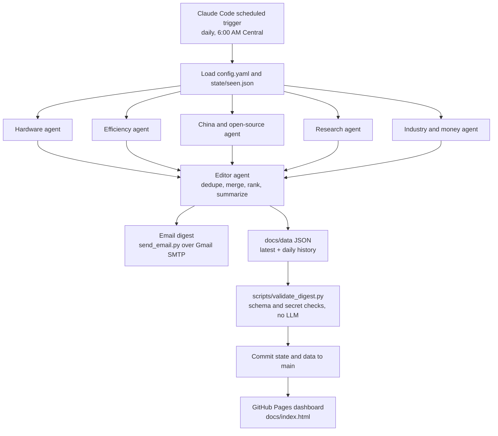

# AI Demand Watch

**A multi-agent research system that scans the web every morning for early
warning signs that demand for AI infrastructure could cool.** Five specialist
research agents (hardware, model efficiency, China and open-source models,
academic research, industry and money) work in parallel, and an editor agent
dedupes, ranks and summarizes what they find. The result arrives as an email
digest and as a public dashboard. It runs entirely as a scheduled Claude Code
session, so there is no server and no paid API bill. It exists because the
huge build-out in AI hardware rests on assumptions (chips stay expensive,
models stay hungry, budgets keep growing) that can change quietly, and a
daily, sourced read on those signals is more useful than headlines.

**Live dashboard:** https://ankittalwar07.github.io/warning-signaks-for-AI-economy-/

> Until the first scheduled run after this branch merges, the dashboard shows
> clearly labeled sample data.

## What this project demonstrates

- **Fan-out / fan-in orchestration.** One session launches five research
  subagents in a single step, then an editor agent merges their output.
- **Specialist agents with narrow briefs.** Each agent has its own beat,
  keywords and output contract, defined in [`config.yaml`](config.yaml).
- **Structured contracts between agents.** Researchers return JSON, the editor
  returns JSON that must pass [`docs/data/schema.json`](docs/data/schema.json),
  and a no-LLM validator gates every commit.
- **Memory and idempotency.** [`state/seen.json`](state/seen.json) keeps a
  30-day fingerprint of every story sent, so nothing repeats.
- **Failure isolation.** A failed agent is retried once, then marked failed in
  the digest and the data; the rest of the run continues.
- **Zero marginal cost.** The model work runs inside a Claude subscription
  session triggered on a schedule, not through metered API calls.

## Architecture



## In plain English

Think of this as **a team of five research assistants who work overnight,
every night, for free.** Each one watches one early-warning topic that could
mean less money flowing into AI:

| Assistant | Watches for | Why it could hurt AI demand |
|---|---|---|
| 🛠 **Hardware** | New cheaper chips (Groq, Cerebras, Amazon, Google) | If they beat Nvidia on price, companies buy fewer Nvidia chips |
| ⚡ **Efficiency** | Smarter, leaner AI models | If AI needs fewer "tokens" to do a job, customers spend less |
| 🇨🇳 **China & open-source** | Free or cheap rival models (DeepSeek, Qwen and others) | If a free model is "good enough", paid demand drops |
| 📄 **Research** | New scientific papers on cutting AI costs | A breakthrough could make today's expensive setups obsolete |
| 💰 **Industry & money** | What big tech says about AI spending | If they signal a pullback, that's a direct demand warning |

Every morning the five assistants each search the web and write up the most
important things they found in the last week. The **editor** throws out
anything already reported, removes duplicates, ranks what's left by how
serious (severity) and how believable (credibility) it is, and writes one
short summary. That summary is emailed, and the same results are published to
the dashboard. Every item links to its source.

## How it runs with zero API cost

1. A **Claude Code on the web scheduled trigger** opens a fresh session on
   this repo once a day. The session follows
   [`triggers/daily-digest.md`](triggers/daily-digest.md).
2. The session uses Claude Code's own `Agent`, `WebSearch` and `WebFetch`
   tools, so all model work draws on the Claude subscription. There is no
   Anthropic or other model API key, no GitHub Actions cron and no server.
3. The editor's digest goes to Gmail through [`send_email.py`](send_email.py)
   (Python standard library plus `markdown`).
4. The same results are written as JSON to `docs/data/`, checked by
   [`scripts/validate_digest.py`](scripts/validate_digest.py), and committed
   to `main` with the updated memory file.
5. GitHub Pages serves [`docs/`](docs/) as a static site. The page only reads
   the committed JSON; it makes no AI calls.

The trade-offs behind each choice (why a scheduled session instead of an API
script, why five specialists instead of one search, why static JSON instead of
a backend) are written up in **[DECISIONS.md](DECISIONS.md)**.

## The dashboard

[`docs/index.html`](docs/index.html), [`docs/app.js`](docs/app.js) and
[`docs/style.css`](docs/style.css): vanilla JavaScript, no build step,
light and dark themes, phone friendly. It shows:

- the five-agents-plus-editor pipeline, with each agent's signal count for the day
- the day's briefing with the editor's summary
- signals grouped by agent, with severity, credibility, source link and date
- filters by agent and by severity
- a history view: signals per day by agent, plus a table that opens any past day

Data contract: [`docs/data/schema.json`](docs/data/schema.json). Files:
`docs/data/latest.json`, `docs/data/history/YYYY-MM-DD.json`,
`docs/data/history/index.json`.

Preview locally:

```bash
python3 -m http.server 8000 --directory docs
# open http://localhost:8000
```

## Setup

### 1. Generate a Gmail App Password

The run sends mail through Gmail's SMTP server, which needs an
[App Password](https://myaccount.google.com/apppasswords), not your regular
account password.

1. Turn on 2-Step Verification on the Gmail account that will send the digest.
2. Visit https://myaccount.google.com/apppasswords
3. Create an App Password for "Mail" and copy the 16-character string (Google
   shows it once).

Workspace accounts may have App Passwords disabled by an admin; a personal
Gmail works as a fallback.

### 2. Create the scheduled trigger

In Claude Code on the web, on `ankittalwar07/warning-signaks-for-AI-economy-`:

- **Name:** AI Demand Watch daily digest
- **Branch:** `main`
- **Schedule:** daily at 6:00 AM `America/Chicago`. If the schedule only
  takes UTC cron, use `0 12 * * *` during standard time (CST, early November
  to mid-March) and `0 11 * * *` during daylight saving time (CDT).
- **Prompt:** `Read triggers/daily-digest.md in this repository and follow every step in it exactly.`
- **Environment secrets** (set in the session environment, never committed):
  - `GMAIL_ADDRESS`: the sending Gmail address
  - `GMAIL_APP_PASSWORD`: the 16-character App Password from step 1
  - `RECIPIENT_EMAIL`: the inbox that receives the digest

The run pushes only `state/seen.json` and `docs/data/` to `main`, so the
trigger's environment needs push access to `main`.

### 3. Turn on GitHub Pages

Settings > Pages > Build and deployment > Deploy from a branch > `main`,
folder `/docs`. The dashboard then appears at the live link above.

### 4. First run

Click **Run now** on the trigger. A run takes a few minutes. Confirm that:

- the email arrives with subject `AI Demand Watch | YYYY-MM-DD | N new signals`
- a `chore(data): digest YYYY-MM-DD` commit lands on `main`
- the dashboard's sample banner is gone and today's briefing shows

## Repo layout

```
.
├── config.yaml                  # the five research agents: name, focus, keywords, limits
├── triggers/daily-digest.md     # the prompt the scheduled Claude session runs each day
├── send_email.py                # reads the Markdown digest on stdin, sends it over Gmail SMTP
├── scripts/validate_digest.py   # stdlib-only check of the dashboard JSON (schema, counts, secrets)
├── state/seen.json              # 30-day memory of stories already sent (URL fingerprints)
├── docs/                        # GitHub Pages site
│   ├── index.html, app.js, style.css
│   └── data/
│       ├── schema.json          # data contract for one day's digest
│       ├── latest.json          # most recent run
│       └── history/             # one file per day, plus index.json for the trend view
├── DECISIONS.md                 # why each design choice was made, in plain language
└── README.md
```

## Editing the watchlist

Edit the `researchers:` list in [`config.yaml`](config.yaml) (add or remove a
beat, tune keywords, change `lookback_days` or `top_n_in_digest`), commit and
push. The next run picks it up. To try a change right away, click **Run now**.
A new beat also needs its `id` added to `agent_id` in
[`docs/data/schema.json`](docs/data/schema.json) and to the agent list at the
top of [`docs/app.js`](docs/app.js).

## Checks

```bash
python3 scripts/validate_digest.py          # validate dashboard data
python3 -m py_compile send_email.py scripts/validate_digest.py
node --check docs/app.js
```

## Troubleshooting

- **No email arrived.** Open the session log. The usual cause is a missing or
  wrong `GMAIL_APP_PASSWORD`. `send_email.py` names any missing variable on
  stderr.
- **"No new signals after dedup".** Normal on slow news days. If it lasts
  three or more days, broaden `keywords` or raise `lookback_days`.
- **Dashboard did not update.** Check the run log for validator output; the
  run skips the data commit if the JSON fails validation. Also confirm Pages
  is set to `main` and `/docs`.
- **Subscription usage cap hit.** The run reports it and tries again the next
  day.
- **Daylight saving drift.** UTC cron does not shift with Central time; see
  the schedule note in setup.

## More multi-agent projects

- **Multi-agent AI investment agent:** https://github.com/ankittalwar07/Multi-agent-AI-investment-agent
  (live UI: https://ankittalwar07.github.io/Multi-agent-AI-investment-agent/)
- **Thesis Builder:** https://github.com/ankittalwar07/thesis-builder
  (live UI: https://ankittalwar07.github.io/thesis-builder/)

## Author

Built by Ankit Talwar. LinkedIn: [LINKEDIN LINK NEEDED]

Signals are research leads, not investment advice.
